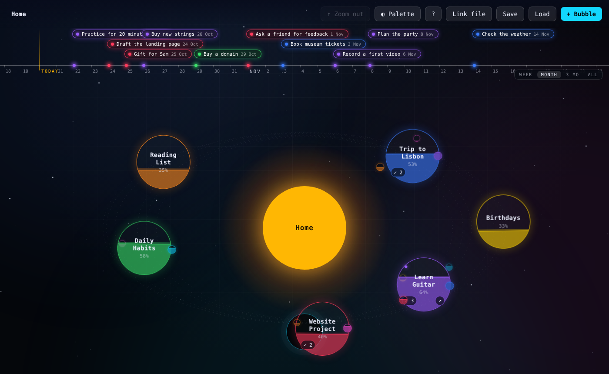
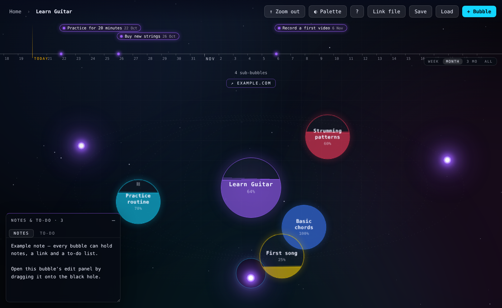

# Orbit

**A space-themed progress tracker. Your projects are planets, sub-projects are moons, tasks are glowing stars — with a due-date timeline on top.**

One HTML file. No install, no server, no account. Your data stays in your browser.

## Try it

Open `index.html` in your browser — that's it. On first launch you get a short welcome and a small example to play with (or start fresh).

Want it online? Enable **GitHub Pages** (Settings → Pages → *Deploy from a branch* → `main` / root) and it is served at `https://<your-username>.github.io/<repo-name>/`.

## What you can do

| | |
|---|---|
| **Planets = projects** | Name them, pick a colour, set progress — the liquid level shows how far along you are. |
| **Closer = more done** | The further along a project is, the closer it orbits the sun. |
| **Fly in** | Click a planet to open its own page and add sub-projects (they orbit as moons). Click the sun or press `Esc` to fly back. |
| **Drag to edit** | Drag a planet onto the black hole to open its edit panel: notes, link, to-dos, progress, colour. |
| **Drag to nest** | Drag a planet onto another planet to make it a sub-project. |
| **Tasks as stars** | **★ Make task** turns a bubble into a small glowing star. Hover to read it. |
| **To-dos + due dates** | Every bubble has a to-do list. Items show as stars in the orbit and on the timeline. |
| **Timeline** | Always visible at the top, scoped to the page you're on. Zoom with **Week / Month / 3 mo / All**. |
| **Merge** | **⛓ Merge** links a bubble to another one, so the same thing can live in two places. |
| **Palettes** | 16 colour palettes. |
| **Home is yours** | Double-click the sun to rename it — use it for projects, hobbies, gifts, birthdays, anything. |

## Saving your data

- Changes are saved **automatically in your browser** (localStorage).
- **Link file** (Chrome, Edge, Brave): pick a JSON file once and Orbit autosaves to it from then on — handy for keeping it in a synced folder.
- **Save / Load**: download or restore a JSON backup, in any browser.

Browser storage is per browser and per file location, so use **Link file** or **Save** if you want a safety net.

## Tech

Plain HTML, CSS and JavaScript — no dependencies, no build step. Everything lives in `index.html`.

## License

MIT — © 2026 Elena Teissier. See [LICENSE](LICENSE).
